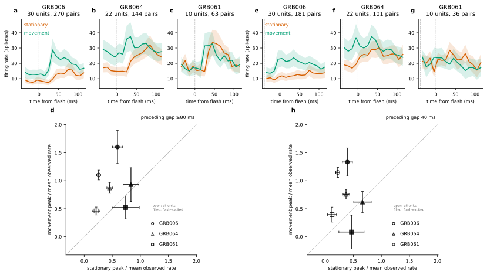
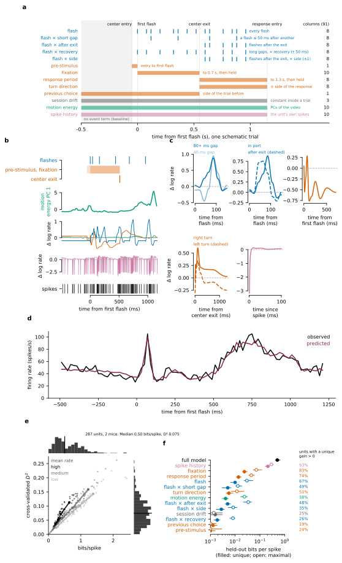

# Movement and sensory responses in V1

Saved results reconciled 2026-11-16. [Reports](figures/README.md) ·
[checks and methods](glm_checks.md) · [decisions](glm_decisions.md).

**Question:** how do visual responses change at center-port exit, and how much
is carried by flash × exit? In-port/after-exit are task periods, not measured
locomotion. The model uses the 2026-10-29 design, τ = 50 ms, and flash × side.

## Sessions and scope

| Mouse | Session | Eligible GLM units | Saved flash-excited units | Status |
| --- | --- | ---: | ---: | --- |
| GRB006 | 20240821_121447 | 172 | 30 | Original analysis |
| GRB064 | 20261008_143359 | 115 | 22 | Original analysis |
| GRB061 | 20261113_133142 | 75 | 10 | Provisional extension |

Sessions follow `behavior.trials.RECORDED`. GRB061 fails the required-wait
criterion (0.37 s required; criterion 0.5 s), has four rates, and is provisional.
Three-mouse values use GRB006 / GRB064 / GRB061 order. Most supporting controls
remain two-mouse; the gap/rank gain control varies by group.

## Result 1: the observed change after exit differs between mice

Quality 1, stability 0, available GLM fits, saved flash-excited classification.
Pair the last in-port and first after-exit 15 ms flashes ≥90 ms apart within a
gap class. Change = baseline-subtracted after-exit minus in-port peak, divided
by the unit's observed mean rate over the paired trials' valid intervals.

| Mouse | Gap | Trial pairs | Mean normalized change | Units higher after exit | Paired p |
| --- | --- | ---: | ---: | ---: | ---: |
| GRB006 | long | 270 | +1.01 | 26/30 | 2.35e-06 |
| GRB006 | short | 181 | +0.94 | 26/30 | 5.14e-06 |
| GRB064 | long | 144 | +0.10 | 14/22 | 0.443 |
| GRB064 | short | 101 | -0.04 | 13/22 | 1 |
| GRB061 | long | 63 | -0.22 | 4/10 | 0.275 |
| GRB061 | short | 36 | -0.38 | 4/10 | 0.322 |

The increase is clear in GRB006; GRB064 and GRB061 do not show the same pattern.
Within-mouse Wilcoxon p values are unadjusted across mice and gaps.

a–c: long-gap PSTHs; e–g: short-gap PSTHs, in mouse order. d/h: group means
with SEM on both axes. Open = all eligible units; filled = nested flash-excited
subset. Circles/triangles/squares = GRB006/GRB064/GRB061. Individual units are not drawn.

## The encoding model: the two original sessions

13 regressor groups, 91 columns, 1 ms bins. All groups pass both inclusion
tests in GRB006 and GRB064; not verified for GRB061.

a: design; b–d: GRB006 example; e–f: 287 units from GRB006/GRB064.
Pooled held-out medians: 0.50 bits/spike, D² = 0.075. [Caption](figures/reports/main_figure_caption.md).

## Result 2: the fitted flash × exit contribution

### Match the observation and predictions

Mean normalized peak changes on identical paired flashes and units. Model
predictions hold out whole trials; removing flash × exit keeps other terms,
observed history, and centering offsets fixed, without refitting.

| Mouse | Gap | Observed | Full model | Without flash × exit |
| --- | --- | ---: | ---: | ---: |
| GRB006 | long | +1.01 | +1.06 | +0.93 |
| GRB006 | short | +0.94 | +1.01 | +1.09 |
| GRB064 | long | +0.10 | +0.21 | +0.51 |
| GRB064 | short | -0.04 | +0.08 | +0.92 |
| GRB061 | long | -0.22 | -0.15 | +0.01 |
| GRB061 | short | -0.38 | -0.17 | -0.05 |

a–c: observed/full/without flash × exit at long gaps; d–f: short gaps.
The plotted peaks are not leak-corrected.

### Correct for an apparent effect created by fitting

Primary measure: full-model log(after exit / in port), minus the same ratio
without flash × exit, minus the held-out no-effect simulation leak. This measures
allocation to a fitted term, not a causal movement effect.

| Mouse | Gap | Units retained | Units excluded | Median corrected log ratio | Paired p |
| --- | --- | ---: | ---: | ---: | ---: |
| GRB006 | long | 24 | 6 | +0.10 | 0.152 |
| GRB006 | short | 25 | 5 | -0.10 | 0.164 |
| GRB064 | long | 15 | 7 | -0.35 | 0.0103 |
| GRB064 | short | 14 | 8 | -0.61 | 0.00671 |
| GRB061 | long | 8 | 2 | -0.19 | 0.945 |
| GRB061 | short | 4 | 6 | -0.02 | 1 |

Ratios require positive peaks and a usable leak; GRB061 short gaps retain only
4/10 units. The normalized sensitivity measure retains all 62 excited units:
long-gap corrected medians +0.16 / −0.14 / −0.09 (p = 0.058 / 0.098 / 0.695).

Mouse-then-unit bootstrap across three mice:

| Gap | Pooled corrected log-ratio median | 95% interval | Bootstrap p |
| --- | ---: | --- | ---: |
| Long | −0.07 | −0.43 to +0.23 | 0.695 |
| Short | −0.21 | −0.62 to +0.05 | 0.092 |

Neither pooled interval excludes zero. GRB064 has the strongest within-mouse
negative contribution; nonsignificance in the other mice does not establish no
effect. Held-out long-gap 80% power occurs at planted log ratios +0.15 / +0.14 /
+0.42; GRB061 short gaps never reach 80% within the tested range. No-effect
simulations also estimate the leak, so centering is not independent validation.

## How the figures were measured

- **Alignment:** measured flash onset on the model's native 1 ms grid, rounded to
  the nearest bin. Use only completed GLM trials with both full response windows
  inside the valid interval.
- **Baseline and peaks:** 10 ms bins, a −40 to 0 ms in-port baseline, and the mean
  within ±20 ms of the largest bin searched at 30–90 ms in port and 30–120 ms
  after exit. Each prediction uses the observed peak window; each source's
  stationary baseline is subtracted from both periods.
- **Gap:** immediately preceding measured pulse of any width; split at ≤50 ms
  (nominal 40 ms) versus >50 ms (nominal 80+ ms). The two paired gaps need only
  share a class, not be exactly equal.
- **Normalization:** one positive observed mean rate per unit over the full
  valid intervals of the paired trials, shared across sources, periods, and gaps.
- **Model removal:** keep all other fitted contributions, observed spike
  history, and the column-centering offset fixed; do not refit coefficients.
- **Uncertainty:** PSTH SEM is across unit trial means. Scatter SEM describes
  variation across units, not trial-sampling or model-fitting uncertainty.
  The report also retains per-unit paired-trial bootstrap SD. Units share trials;
  mouse-then-unit bootstrap intervals have only three mice at their upper level.
- **Exclusions:** 286 / 161 / 73 trials have flashes in both periods; 14 / 17 / 9
  have no long-gap pair and 101 / 60 / 37 no short-gap pair. Incomplete model
  windows exclude 6 / 0 / 1 pairs across classes. These counts are separate from
  the log-ratio exclusions above.
- **Display:** all finite unit peaks, including zero and negative values, enter
  group means. Axes cover the complete group SEM bars; individual outliers are
  not shown. Observed values are black and model predictions wine.

## Run

Requires matching cached trials, classifications, designs, and saved fits.
GRB061's simulation archive was unavailable; its correction and the three-mouse
pooled intervals are report-backed, not independently recalculated here.

~~~bash
THESIS_CACHE_DIR=figures/cache uv run python -m thesis.ephys.analyses.glm.flash_movement
~~~
