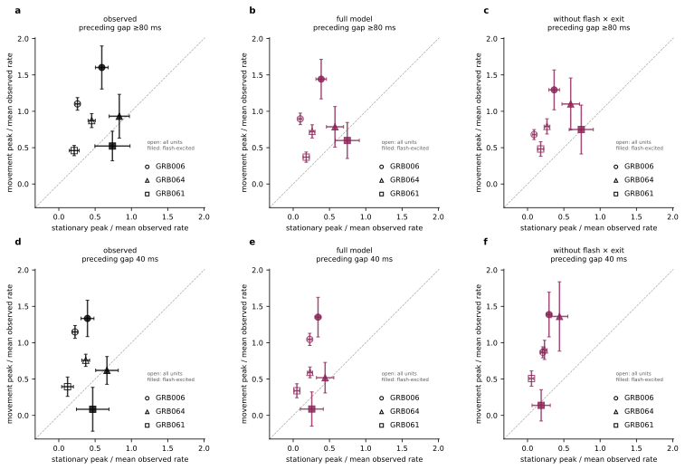

# Movement and sensory responses in V1

Reconciled on 2026-11-16 against the [saved figure reports](figures/README.md).
These are results from saved fits and analyses, not a new fit or a refresh from
the live database. Historical model choices remain in the [decision log](glm_decisions.md).

- **Question:** how do visual responses change around center-port exit, and how
  much of that change is carried by the fitted flash × exit term?
- **Comparison:** in-port and after-exit task periods. These are not a direct
  measurement of locomotion. Choice, side, elapsed time, and flash history also
  change around exit.
- **Model:** the 2026-10-29 design, including flash recovery with τ = 50 ms and
  flash × side. Candidate terms discovered on these data require new-session
  validation. Removing a fitted term below does not refit any coefficients.

## Sessions and scope

| Mouse | Session | Eligible GLM units | Saved flash-excited units | Status |
| --- | --- | ---: | ---: | --- |
| GRB006 | 20240821_121447 | 172 | 30 | Original analysis |
| GRB064 | 20261008_143359 | 115 | 22 | Original analysis |
| GRB061 | 20261113_133142 | 75 | 10 | Provisional extension |

The current session list is `behavior.trials.RECORDED`. GRB061 has a 0.37 s
required wait and a 0.48 s median center-port time, so it fails the 0.5 s
required-wait criterion. It is retained provisionally and has only four stimulus
rates. It should not be treated as an equivalent expert-session replication.

The flash observation, matched model comparison, isolated-kernel figure,
first-flash check, power analysis, and in-port movement figure include all three
mice. The encoding-model overview and the older raw-video, per-unit gain, decoding, side,
and depth controls remain two-mouse results. Their conclusions do not extend to
GRB061 without running those controls. The gap/rank gain control includes two
or three mice depending on the group, as listed in the supplement. Within three-mouse sections, slash-separated
values use **GRB006 / GRB064 / GRB061** order; two-mouse controls name their scope.

## Result 1: the observed change after exit differs between mice

- **Why:** the PSTHs show the response time course, and the paired peaks summarize
  the change within units.
- **Selection:** quality criterion 1, stability parameter 0, available GLM fits,
  and the saved flash-excited classification. Within each preceding-gap class,
  pair the last in-port 15 ms flash with the first after-exit 15 ms flash at
  least 90 ms later. A trial can contribute to both classes.
- **Measure:** baseline-subtracted peaks divided by each unit's observed mean
  rate over the valid intervals of the paired trials. The difference is
  after exit minus in port. Values below are means across flash-excited units.

| Mouse | Gap | Trial pairs | Mean normalized change | Units higher after exit | Paired p |
| --- | --- | ---: | ---: | ---: | ---: |
| GRB006 | long | 270 | +1.01 | 26/30 | 2.35e-06 |
| GRB006 | short | 181 | +0.94 | 26/30 | 5.14e-06 |
| GRB064 | long | 144 | +0.10 | 14/22 | 0.443 |
| GRB064 | short | 101 | -0.04 | 13/22 | 1 |
| GRB061 | long | 63 | -0.22 | 4/10 | 0.275 |
| GRB061 | short | 36 | -0.38 | 4/10 | 0.322 |

The increase is clear in GRB006, small and uncertain in GRB064, and absent in the
provisional GRB061 session. A nonsignificant comparison does not establish equality.
The p values are within-mouse Wilcoxon tests, unadjusted across mice and gap classes.

**Panels:** a–c show long-gap PSTHs for GRB006, GRB064, and GRB061; e–g show
short-gap PSTHs in the same order. Panels d and h show long- and short-gap
normalized peak group means. Circles, triangles, and squares identify those
mice. Open markers include all eligible units; filled markers include the nested
flash-excited subset. Bars are SEM across units on both axes. Individual units
are not drawn, so these panels do not show the full distribution.

## The encoding model: the two original sessions

The Poisson GLM uses 13 regressor groups, 91 columns, and 1 ms bins. It combines
flash history and its gap, exit, recovery, and side modifiers with task events,
video motion energy, and spike history. In the saved overview, all 13 groups pass
the two inclusion tests in each original mouse. This statement has not been
verified for GRB061.

Panel a shows the design; b–d show one GRB006 example; e–f summarize **287 units
from GRB006 and GRB064**. The pooled median is **0.50 bits/spike** and **D² =
0.075**, relative to a constant rate. The overview is deliberately scoped to the
original two sessions; the three-mouse flash plots are a separate extension.
[The saved caption](figures/reports/main_figure_caption.md) defines its panels and tests.

## Result 2: the fitted flash × exit contribution

### Match the observation and predictions

Compare observed peaks, whole-trial held-out model predictions, and the same
predictions with the raw flash × exit contribution removed. They use identical
units, paired flashes, valid windows, baseline rules, and observed normalization.
The table gives the mean after-exit minus in-port peak in each column.

| Mouse | Gap | Observed | Full model | Without flash × exit |
| --- | --- | ---: | ---: | ---: |
| GRB006 | long | +1.01 | +1.06 | +0.93 |
| GRB006 | short | +0.94 | +1.01 | +1.09 |
| GRB064 | long | +0.10 | +0.21 | +0.51 |
| GRB064 | short | -0.04 | +0.08 | +0.92 |
| GRB061 | long | -0.22 | -0.15 | +0.01 |
| GRB061 | short | -0.38 | -0.17 | -0.05 |

Columns a–c are observed, full model, and without flash × exit at long gaps;
d–f repeat them at short gaps. Removing the term changes predicted enhancement
in different directions across mice. These plotted peaks have **not** been
leak-corrected; their difference alone is not the final inferential result.

### Correct for an apparent effect created by fitting

The primary measure is log(after exit / in port) in the full model minus the
same log ratio without flash × exit, minus its simulated no-effect leak. The
held-out measure uses the held-out leak from the no-effect power simulations
for these flash-excited units. This asks about allocation to a fitted term,
not a causal movement effect or a comparison of refitted model families.

| Mouse | Gap | Units retained | Units excluded | Median corrected log ratio | Paired p |
| --- | --- | ---: | ---: | ---: | ---: |
| GRB006 | long | 24 | 6 | +0.10 | 0.152 |
| GRB006 | short | 25 | 5 | -0.10 | 0.164 |
| GRB064 | long | 15 | 7 | -0.35 | 0.0103 |
| GRB064 | short | 14 | 8 | -0.61 | 0.00671 |
| GRB061 | long | 8 | 2 | -0.19 | 0.945 |
| GRB061 | short | 4 | 6 | -0.02 | 1 |

A log ratio requires positive peaks and a usable simulated leak. The short-gap
GRB061 result retains only **4 of 10 units**, so it has a particularly narrow
selection. The normalized sensitivity measure retains all 62 flash-excited units;
its long-gap corrected medians are **+0.16 / −0.14 / −0.09** (p = **0.058 /
0.098 / 0.695**).

Across all three mice, the saved hierarchical mouse-then-unit bootstrap gives:

| Gap | Pooled corrected log-ratio median | 95% interval | Bootstrap p |
| --- | ---: | --- | ---: |
| Long | −0.07 | −0.43 to +0.23 | 0.695 |
| Short | −0.21 | −0.62 to +0.05 | 0.092 |

These replace the earlier two-mouse pooled summaries. Neither interval excludes
zero. Three mice, with one provisional session, do not support a precise
population claim. Within-mouse evidence for a negative contribution is strongest
in GRB064; the nonsignificant GRB006 and GRB061 results do not establish no effect.

### Can this test detect an increase?

In the saved simulations, held-out long-gap 80% power is reached at planted log
ratios of **+0.15 / +0.14 / +0.42**. No-effect p < 0.05 rates are **4.0% / 5.0% /
4.5%** over 200 simulations. GRB061 has much lower sensitivity; short-gap 80%
power was not reached within its tested range. The no-effect simulations also
estimate the leak, so their centering is not independent validation.

## What this supports

The apparent increase after exit is not shared across the three sessions. The
saved model comparison does not establish a common positive flash × exit
contribution; it also does not exclude a positive effect of meaningful size.

Two-mouse gain, adaptation, side, and decoding controls help interpret GRB006 and
GRB064. They are not yet a demonstrated explanation of all three mice. In-port
motion-energy slopes are negative in all three sessions, but GRB061 is uncertain
(p = 0.084). This relation is observational and does not isolate movement from
engagement or other state changes. See [the supporting checks](glm_checks.md).

## How the figures were measured

- **Alignment:** measured flash onset on the model's native 1 ms grid, rounded to
  the nearest bin. Use only completed GLM trials with both full response windows
  inside the valid interval.
- **Baseline and peaks:** 10 ms bins, a −40 to 0 ms in-port baseline, and the mean
  within ±20 ms of the largest bin searched at 30–90 ms in port and 30–120 ms
  after exit. Each prediction uses the observed peak window; each source's
  stationary baseline is subtracted from both periods.
- **Gap:** immediately preceding measured pulse of any width; split at ≤50 ms
  (nominal 40 ms) versus >50 ms (nominal 80+ ms). The two paired gaps need only
  share a class, not be exactly equal.
- **Normalization:** one positive observed mean rate per unit over the full
  valid intervals of the paired trials, shared across sources, periods, and gaps.
- **Model removal:** keep all other fitted contributions, observed spike
  history, and the column-centering offset fixed; do not refit coefficients.
- **Uncertainty:** PSTH SEM is across unit trial means. Scatter SEM describes
  variation across units, not trial-sampling or model-fitting uncertainty.
  The report also retains per-unit paired-trial bootstrap SD. Units share trials;
  mouse-then-unit bootstrap intervals have only three mice at their upper level.
- **Exclusions:** 286 / 161 / 73 trials have flashes in both periods; 14 / 17 / 9
  have no long-gap pair and 101 / 60 / 37 no short-gap pair. Incomplete model
  windows exclude 6 / 0 / 1 pairs across classes. These counts are separate from
  the log-ratio exclusions above.
- **Display:** all finite unit peaks, including zero and negative values, enter
  group means. Axes cover the complete group SEM bars; individual outliers are
  not shown. Observed values are black and model predictions wine.

## Reproduction and sources

The [saved reports](figures/README.md) preserve the numeric evidence behind these
summaries. Saved results can differ from a fresh database query after parser,
sync, or classification updates. Reproducing the figures requires the matching
trials, classifications, designs, and fits; CI does not regenerate them.
The GRB061 simulation archive was unavailable locally; its correction and the
three-mouse pooled intervals are report-backed, rather than independently
recalculated from simulations during this reconciliation.

~~~bash
THESIS_CACHE_DIR=figures/cache nice -n 10 uv run python -m thesis.ephys.analyses.glm.flash_movement
~~~

[Supporting checks and methods](glm_checks.md) · [Paper story](paper-story.md) ·
[Historical decisions](glm_decisions.md)
