# V1 GLM: validation and supporting results

Saved analyses, reconciled 2026-11-16. Default order/scope: **GRB006 / GRB064**.
Sections naming three mice add provisional **GRB061** last. The gap/rank gain
control varies by group. [Sessions](glm.md#sessions-and-scope) · [reports](figures/README.md).
Model: 2026-10-29 design, τ = 50 ms, flash × side.

## Does the fit support interpretation of the flash component?

### What do the isolated flash-kernel peaks show?

Three mice, 30 / 22 / 10 excited units. Mean after-exit minus in-port final-fit
kernel peaks: **+0.047 / −0.151 / −0.106 Δ log rate** at long gaps and
**+0.009 / −0.188 / −0.043** at short gaps. Open markers: all 172 / 115 / 75
units; filled: excited subset. Bars: SEM across units on both axes. This kernel
measure has no independent leak correction and is not a peak-rate contribution.

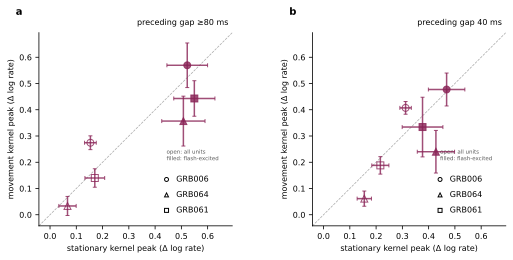

### Do the flash weights agree with the StimulusResponse table?

Three mice, 172 / 115 / 75 units; 30 / 22 / 10 saved excited classifications.
Raw response: 30–120 ms against −40–0 ms. Flash-weight AUC: **0.91 / 0.95 / 0.93**;
ρ with recomputed response: **0.64 / 0.80 / 0.69**. Including all first-flash-locked
terms gives AUC **0.93 / 0.98 / 0.84**, ρ **0.86 / 0.94 / 0.81**.

Maximum recomputed-versus-stored rate delta: **0.105 / 0.000048 / 0.000049 spikes/s**;
the old GRB006 agreement claim was wrong. Classifications were not refreshed.
The fold-interval rule leaves 13 / 10 / 5 excited units unclassified and calls
none suppressed by flash weights. Two GRB006 excited units have nonpositive
weights. [Report](figures/reports/flash_weight_check.json).

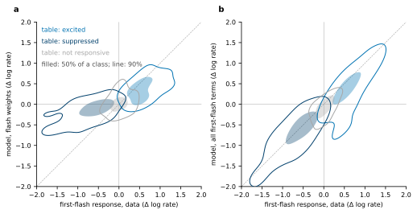

### False-effect check: can the fit create an apparent flash × exit effect?

The three-mouse corrected rate results and exclusions are in [the main tables](glm.md#result-2-the-fitted-flash--exit-contribution).
Held-out excited-unit estimates use held-out no-effect leaks; final-refit
corrections are separate. [Report](figures/reports/leak_test.json).

Long-gap mean leaks: −0.57 / −0.25 / +0.05 normalized; real contributions:
+0.13 / −0.30 / −0.16. Corrected medians: +0.16 / −0.14 / −0.09
(p = 0.058 / 0.098 / 0.695). Pooled median +0.04, 95% −0.19 to +0.23.
Pairs share a gap class, not an exact gap: median in-port/after-exit gaps are
120/120, 81/120, 119/120 ms.

The figure below remains **two-mouse** kernel validation and an older rate-scale
correction, not the primary three-mouse log-ratio result. Known fixation weights
recover at only about 0.70 / 0.76 of their size; repeatability does not exclude bias.

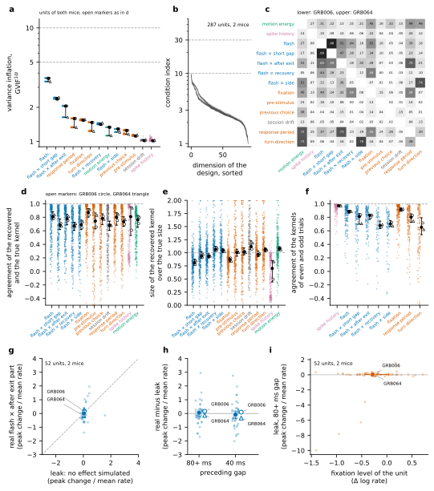

### Is the low rate during fixation explained by visual input or stillness?

- **Finding:** normalized firing is **0.62 / 0.66** late in fixation and **1.37 / 1.18** after exit. Firing can fall before the first flash and rises at early withdrawal when flashes stop. Rate rises with motion energy at the side port, but not at the center port. These controls support a fixation-linked change; they do not isolate its cause. At the same low motion, the rate in the center port is lower than at a side port in both mice (median ratio 0.72 / 0.80, p = 5e-9 / 0.04); early withdrawal also adds a punishment tone.
- **Next:** retain a task-period rate component when estimating flash responses. Panels a–f show the rate change and its timing; g–i check movement and which units show it. The fixation kernel passes the inclusion test (unique deviance with all other terms in the model), so it is not a part of the rate that other terms explain; a two-step fit (other terms first) was removed on 2026-10-29.

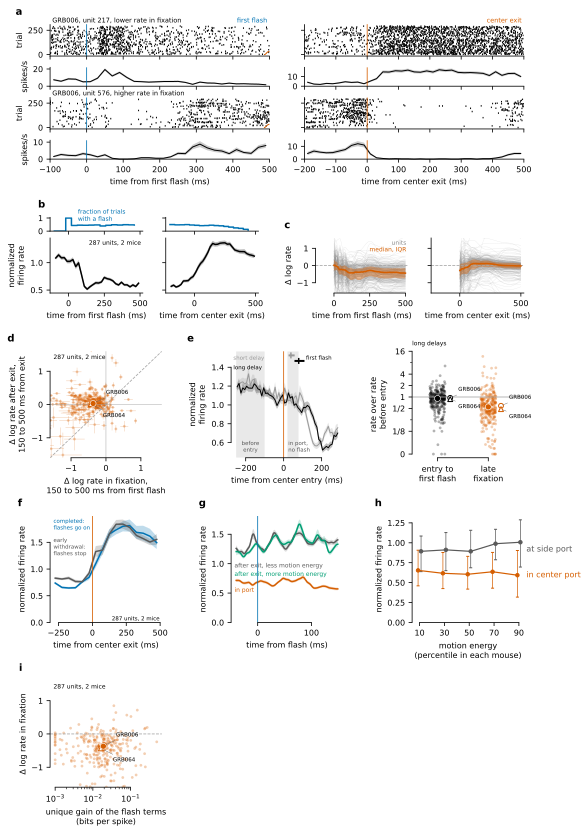

### Does the model reproduce the observed flash-response time courses across gaps?

- **Finding:** observed and fitted matched peaks are higher after exit across the gap groups in both mice. The traces compare timing and shape within gap and task period (black: observed; wine: predicted). They include background and preceding-flash responses and use the final refit, so this is an in-sample check, not an isolated sensory-gain estimate.
- **Next:** use this check to assess the flash-history model; use the simulation results above to qualify an exit-effect interpretation.

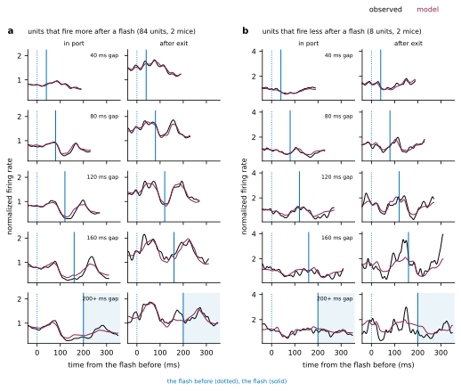

### First flash during movement: which flash response does the model miss after the exit?

Three mice, 30 / 22 / 10 excited units. Miss = observed window peak minus
peak from spikes drawn from the held-out model rate. First-flash mean misses:
**+0.03 / +0.02 / +0.08** (p = 0.529 / 0.063 / 0.557).

At matched post-exit times, mean flash-minus-no-flash misses are
**+0.35 / +0.38 / −0.26** (p = 0.010 / 0.021 / 0.557). Three-mouse pooled median
**+0.25**, 95% **−0.06 to +0.45**, p = **0.109**; the old positive pooled interval
was two-mouse. Only 27 / 20 / 15 no-flash trials; pseudo-flash times are 54 / 48 /
39 ms after exit. Flash presence and stimulus history are not randomized.
[Report](figures/reports/first_flash_after_exit.json).

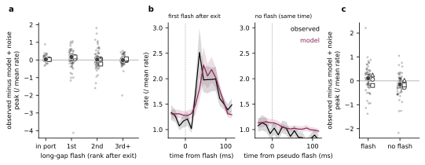

### How fast do flash responses recover from adaptation?

- **Finding:** in-port flash peaks of GRB006 rise with the gap and level off by about 200 ms, at the level of the first flash of a trial. Response (window peak since 2026-11-15) = A (1 − c exp(−gap / τ)), with c free (30 excited units, without the 40-ms group, where the flash before overlaps the measure), gives **τ = 56 ms** (95% 31 to 92): the curve is 0 up to about **80 ms** (τ ln c), rises fast, and is recovered by about 200 ms. GRB064 follows the same curve with τ fixed, and on its own gives 78 ms (45 to 131). With the largest bin (until 2026-11-15): τ = 54 ms (29 to 91), 0 up to 68 ms, GRB064 97 ms (52 to 180); the model's τ = 50 ms (from the largest-bin fit) is inside both intervals. Until 2026-10-24 c had a bound of 1.5 (with no recorded reason), which gave τ = 118 to 121 ms and a worse fit (χ² 11.1 against 4.0 on 4 df).
- **The τ of the model:** in the model, c goes into each unit's recovery weight, and only τ sets the shape of the term. On the 80 grid units (`tau_grid.py`, rule fixed before the run), τ = 40, 60, 80 and 160 ms predict the same as 120 ms (median change of D² below 0.0001, Holm p ≥ 0.72). So prediction does not choose τ, and the model uses the τ of the fit with c free, rounded to 10 ms: **τ = 50 ms** (from 2026-10-24; 120 ms before). A second run with 50 ms as the reference (2026-10-28, the same 80 units) agrees: τ = 40, 60, 80, 120 and 160 ms predict the same as 50 ms (median change of D² below 0.0001, 31 to 48 of 80 units better, Holm p ≥ 0.43), so τ stays at 50 ms. With it the term passes the inclusion rule in both mice (28% / 23% of units); with 120 ms it passed in 25% / 28% and added **+0.0036 / +0.0032 bits per spike** in the flash-excited units of the inclusion test (2026-10-23, before the gain fix: 18 of 23, 13 of 15 better).
- **Next:** the term takes about a third to a half of the miss at long gaps. It shares a direction with the start of the fixation kernel (first canonical correlation 0.56 / 0.58, `model_trust.svg` panel c): the first flash of each trial is fully recovered and starts the fixation kernel.

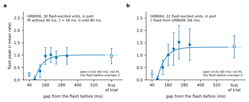

### Gain on all activity: what changes the flash response at the exit?

- **Measure:** pooled flash-excited-unit responses, window peaks, and a
  hierarchical mouse-then-unit bootstrap. A session needs at least 12 flashes
  in a group. Cohort membership therefore varies by group; the figure is not
  a uniform three-mouse comparison. Each gain ratio uses its stated mice.
- **Finding:** the [current report](figures/reports/exit_flash_responses.json)
  gives the following ratios relative to in-port flashes at the same gap:

| Flashes after exit | Gap | Mice included | Peak growth | Pre-flash rate growth | Peak growth / rate growth, 95% interval |
| --- | --- | --- | ---: | ---: | --- |
| Later | 100–200 ms | GRB006 / GRB064 / GRB061 | 1.05 | 1.42 | 0.74, 0.32–1.15 |
| First | 100–200 ms | GRB006 / GRB064 | 2.20 | 1.23 | 1.78, 1.03–2.94 |
| First | 200+ ms | GRB006 / GRB064 / GRB061 | 1.15 | 1.77 | 0.65, 0.21–1.30 |

- **Interpretation:** the positive excess at the first 100–200 ms flash remains
  a two-mouse result. The other intervals include a ratio of 1, and neither
  establishes one shared gain. The third mouse has not replicated the positive
  first-flash excess in that gap group because it is not included there.
- **Unstable ratios:** at 50–100 ms the in-port peak interval includes zero.
  Those gain ratios remain in the report but are omitted from the figure;
  they are not reliable response-gain estimates. Exclusions must not be read
  as evidence of no effect.
- **Model miss:** at the first 100–200 ms flash it is +0.10 (−0.21 to +0.55),
  from the original two mice; at the first 200+ ms flash it is −0.01 (−0.52 to
  +0.37), from three mice. These intervals do not establish perfect prediction.
- **Separate controls:** the [per-unit gain comparison](#gain-on-all-activity-per-unit-is-the-larger-flash-response-after-the-exit-one-gain)
  and recovery fit remain two-mouse analyses. The historical suppressed-unit
  dip test also remains a separate two-mouse analysis and is not shown in this
  excited-unit figure. Its in-port dip was near zero, making gain ratios unstable.
- **Next:** adaptation reset and state gain remain interpretations to test,
  not uniquely established causes. There is no head tracking to distinguish
  them from a visual-field change.

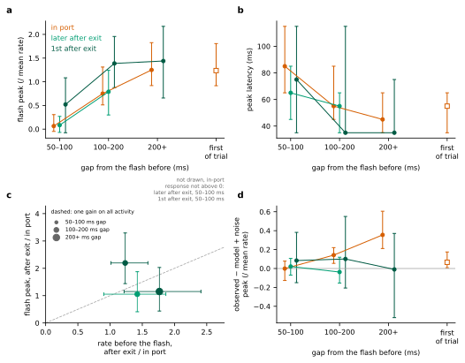

### Prediction accuracy: is the predicted rate calibrated over its range?

- **Finding:** held-out 1-ms bins of each unit sorted into 20 groups by predicted rate (`calibration.py`). From the 5th to the 70th percentile the model is too high (observed / predicted **0.84 to 0.95**); from the 75th to the 95th it is too low (**1.02 to 1.12**). Both mice have the same curve; a fit with a 100 times weaker penalty on the fixation kernel (removed 2026-10-29) had the same curve.
- **Next:** the model compresses its range by about 10%, so its effect sizes are a little too small. The cause is not known: one gain on the linear predictor and a cubic output function were tested earlier and did not help ([decision log](glm_decisions.md)).

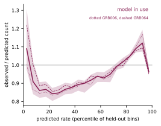

## Movement measure: do the conclusions depend on the video model?

These fits are of the model of 2026-10-29 (run 2026-11-07; GRB064 20261008). The kernel comparisons use six fixed task terms; flash recovery and flash × side are in both models but are not compared. The results of the design of 2026-10-17 (GRB064 20260916) are in `results/glm/_raw_video_design_2026_10_17/`.

### Does raw video improve held-out spike prediction?

- **Finding:** adding 10 raw-video PCs to 10 motion-energy PCs improves median paired D² by **+0.00051 / +0.00142** across all **287** eligible units and the same ten folds. Prediction improves in **123/172 / 97/115** units (Wilcoxon p = 3e-13 / 1e-13). Pooled gain is **0.00083 D²**, 95% interval **0.00043–0.00169**. Coefficients and penalties are re-estimated; video preprocessing is not fully nested.
- **Next:** better prediction does not establish more accurate task weights. Check their levels, repeatability, and recovery below.

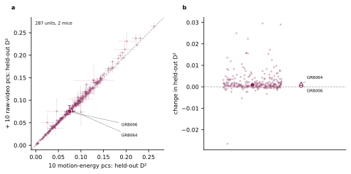

### Does raw video change the estimated size of fixation suppression?

- **Finding:** median fixation levels become less negative: **−0.364 → −0.312 / −0.445 → −0.355 Δ log rate**. Pooled paired change is **+0.055**, 95% interval **0.044–0.084**. Fixation and flash changes pass Holm correction in both mice (the flash changes are small, +0.008 / +0.012); the short-gap and response-period changes pass only in GRB006; signed turn and flash × exit changes do not pass. Bars show fold SD on both axes, not independent confidence intervals.
- **Next:** the magnitude is sensitive to video modeling. Check whether adding video improves repeatability or resolves estimation bias before choosing between the weight estimates.

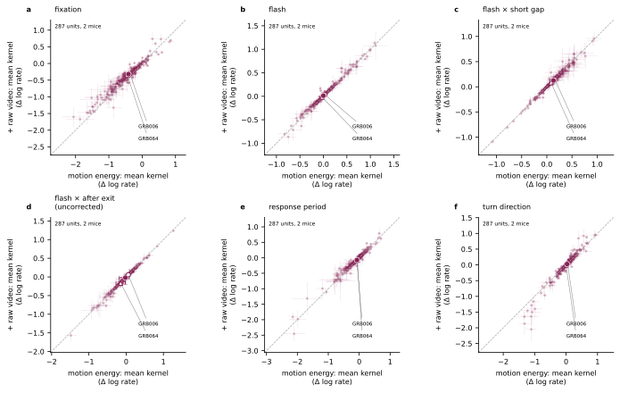

### Does better prediction give more repeatable task weights?

- **Finding:** among all eligible units, fixation agreement falls **0.870 → 0.849 / 0.907 → 0.874**; both changes pass correction for six tests per mouse (p = 3 × 10⁻¹² / 4 × 10⁻⁶). Flash agreement also falls a little (0.859 → 0.839 / 0.835 → 0.806, p = 0.003 / 0.003). Turn agreement rises **0.511 → 0.557 / 0.450 → 0.480**; neither change passes correction (p = 0.31 / 0.23). This all-unit selection differs from the needed-term selection in the main model checks.
- **Next:** prediction and repeatability do not pick one model uniformly. Simulations with known weights test the remaining bias.

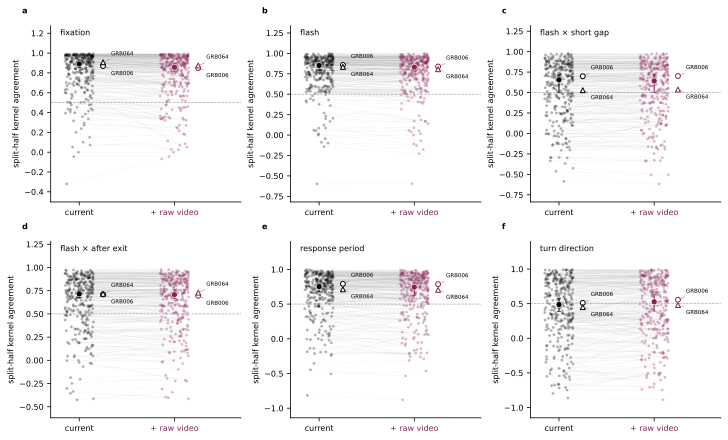

### Does raw video resolve the known recovery and leak problems?

- **Finding:** in the fixed **20-unit pilot per mouse**, fixation-level recovery changes **0.763 → 0.598 / 0.747 → 0.849** (15 / 19 paired units), so it does not improve in a consistent direction. Largest condition indices rise **10.1 → 15.9 / 10.0 → 10.7**, below the chosen limit of 30. Corrected flash × exit kernel medians do not change with raw video and remain different in the two mice: **+0.023 → +0.035 / −0.253 → −0.242 Δ log rate** (GRB064 Holm p = 0.002 in both models). Each model has its own simulated truth and spikes. Only **three / seven** pilot units are classified as excited, so their matched peaks cannot settle the population result.
- **Next:** retain raw video as a sensitivity control. It does not resolve fixation-weight bias; the small pilot cannot resolve the sensory question.

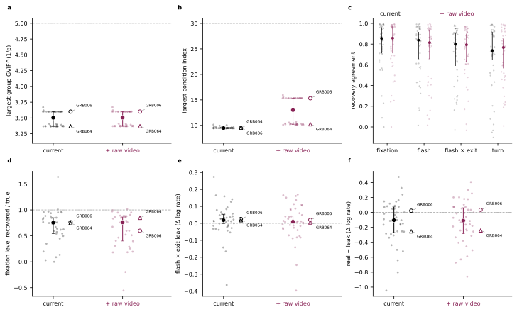

## Check: does the turn term take the side preference?

### Does removing the fitted turn contribution remove the predicted preference?

- **Finding:** observed versus predicted side-index agreement falls from **ρ = 0.990 / 0.948** to **0.633 / 0.637** when the fitted turn contribution is removed. Median absolute error rises from **0.010 → 0.141 / 0.017 → 0.167**. Keeping turn lowers error in **166/172 / 109/115 units**; pooled paired error reduction is **0.117**, 95% interval **0.098–0.148**. Flash × side is not removed, so it keeps a part of the side signal. This removes one contribution without refitting; other terms and observed spike history remain.
- **Next:** test whether raw-video components absorb this contribution. The current comparison shows fitted allocation, not unique information or a causal effect of turning.

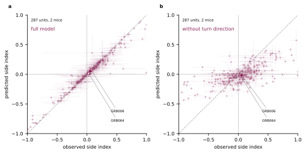

### Does the fitted turn contribution survive adding raw video?

- **Finding (model of 2026-10-29, run 2026-11-07):** with 10 added raw-video components, full-model agreement is **ρ = 0.988 / 0.947** and falls to **0.531 / 0.299** without turn. Median error rises from **0.011 → 0.145 / 0.017 → 0.195**; keeping turn lowers error in **168/172 / 105/115** units; pooled paired error reduction is **0.125**, 95% interval **0.105–0.176**. The fitted turn contribution remains large, although its allocation among shared signals changes.
- **Next:** the fitted term takes much of the preference under both video models, as it was built to. Linking it to choice decoding remains open. This is a check of the turn term; it does not settle the sensory-response question.

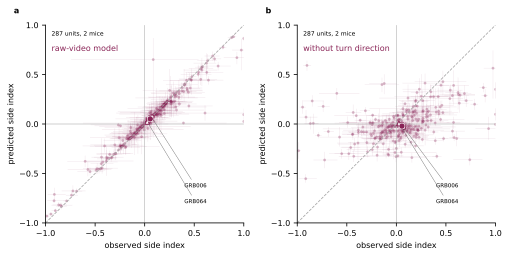

## Result 4: decoding stimulus and choice

`glm/decoding_without_terms.py`: a decoder on the rates 300 ms before and after the center exit, from the observed spikes, with the fitted flash part divided out, and with all other model terms divided out (each trial changed by the fold model that held it out). GLM sessions and units (172 / 115); trials balanced for category × choice; chance is the 2.5–97.5% range of a mean AUC over shuffles.

### Is the category signal around the exit visual?

- **Finding:** without the flash terms the category AUC falls by **0.09 / 0.16** after the exit (GRB064 to 0.59, at the top of chance, 0.40–0.59) and by **0.10 / 0.07** in the port; without all other terms it changes by **≤ 0.02**. Single units and multi-units (636 / 485) add **+0.03 / +0.01** after the exit, so the GLM units carry almost all of the decoder's category signal there (in the port +0.04 / +0.00).
- **Limits:** spike history stays in all versions; with the single largest bin the model missed most of the first flash after the exit (with the window peak it misses little, 2026-11-15), so the GRB006 value after the removal (0.75) is an upper limit of a non-visual signal; "visual" means what the GLM gives to the flash terms.
- **The first flash after the exit is not the leftover (2026-10-29):** with 150 ms after the first flash at or after the exit left out of the after-exit window (`--mask-first-exit-flash`; 225 / 133 trials), the AUC without the flash terms is **0.80 / 0.56** (from 0.75 / 0.59; chance 0.45–0.57 / 0.40–0.58). So the response that the model misses does not carry the GRB006 leftover.
- **What the leftover is (`category_leftover.py`, 2026-11-06):** after the exit, within each choice, the log of the mean rate of high-rate minus low-rate trials (median over units) is +0.22 / −0.03 observed, and the flash part of the model gives +0.07 / −0.05 (in GRB064 the model predicts a lower rate at high flash rates, from more adaptation). The rest is **+0.20 / +0.06** (higher in high-rate trials in 78% / 73% of 170 / 106 units, p = 2e-16 / 1e-4), and the other part of the model is +0.005 / +0.009. So in both mice the model predicts too low a rate in high-rate trials (too much adaptation, or too little summation, when flashes are close together), and the decoder finds the category in that miss. The script of 2026-10-29 (+0.07 / +0.07, GRB064 20260916) was lost; its exact definition is not known, and the new definition gives a larger GRB006 rest with the same sign. This is a miss of the flash model, not evidence for a category signal that is not visual. The model is frozen; a term for this is a candidate for new sessions.

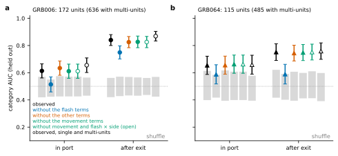

### Is the choice signal after the exit a flash response moved in the visual field?

- **Model term:** flash × side (`dmat.FLASH_SIDE`, in the model since 2026-10-29): the after-exit flash kernel times the side of the response. In the model (inclusion test of the main fit, all units) it **passes the inclusion rule in both mice**: **56 / 172 and 44 / 115** units need it, median held-out gain **+0.0032 / +0.0022 bits per spike**, Holm p 2e-18 / 3e-9. Before it entered the model, `candidate_terms.py` (the design in use plus this term) gave the same GRB006 values; there the turn term kept most of its share (unique ΔD² 0.00095 → 0.00073 / 0.00187 → 0.00171, GRB064 20260916) and still passed. The two terms share a direction in the design (first canonical correlation 0.78 / 0.74, `model_trust.svg` panel c).
- **Shape (final refit, 2026-11-06):** in the units that need it (unique ΔD² test over folds, 57 / 43), the kernel has the shape of a flash response, not of a side offset: mean signed by each unit's own direction 0.00 / +0.01 at 0–20 ms, **+0.22 / +0.24 at 60–80 ms**, −0.07 / 0.00 at 120–150 ms. So part of the side signal after the exit is locked to the flashes.
- **Direction (final refit, 2026-11-06):** the mice have opposite directions. With the sign kept (+ = larger flash response for a right turn, kernel mean 40–100 ms), GRB006 has median **−0.05** (positive in 33% of 172 units, Wilcoxon p = 3e-5) and GRB064 **+0.04** (70% of 115, p = 5e-5); in the flash-excited units −0.06 (p = 0.12) / +0.02 (p = 0.57). In GRB006 the units with larger flash kernels have more negative side kernels (Spearman ρ = −0.34, p = 4e-6); GRB064 has no such relation (ρ = −0.01), and the side kernel does not change with depth (ρ = 0.14, p = 0.14; on 20260916 it did, ρ = 0.23, p = 0.04). Both mice have the same rule (high rate → right port). A right turn moves the panel to the left of the visual field; in the binocular zone of left V1 the direction of the change depends on where the receptive fields lie, and there is no retinotopy, so the opposite directions do not decide between a visual-field shift and a side-specific gain.
- **Decoding:** it cannot separate the two side terms. Without the flash terms (with flash × side) the choice AUC stays **1.00 / 0.97**; without the other terms (the turn term among them) it is **0.90 / 0.90** with flash × side in the model (GRB064 20261008; 0.80 on 20260916), against 0.66 / 0.60 without it. With flashes every 50–250 ms, a flash-locked side kernel summed over a 300 ms window is close to a constant side signal, so either term carries the choice.
- **Limits:** a flash response that differs with the side can come from the new position of the panel in the visual field, or from a side-specific gain of the flash response; the data have no head or eye position to tell them apart. Adding flash × side to the model changed the category results by ≤ 0.01. The figures are of the model with flash × side.

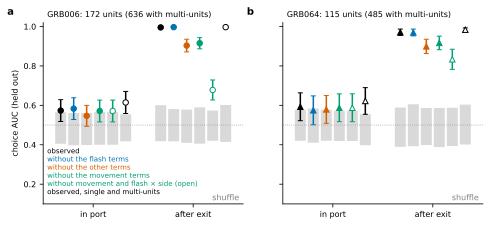

## Follow-ups of 2026-10-29

### Sensitivity check: could the flash × exit test find an effect?

- **Measure (`power_test.py`):** all three mice, **30 / 22 / 10** excited units.
  Simulate spikes with a planted flash × exit contribution and refit at the
  saved penalties. A detection requires Wilcoxon p < 0.05 and a positive median.
  There are 200 no-effect simulations and 50 per planted size. Final refits and
  whole-trial held-out predictions are evaluated separately.
- **Finding:** the [saved power report](figures/reports/power_test.json) gives:

| Mouse | Long-gap 80% power, final refit | Long-gap 80% power, held out | Held-out no-effect p < 0.05 |
| --- | ---: | ---: | ---: |
| GRB006 | +0.17 | +0.15 | 4.0% |
| GRB064 | +0.15 | +0.14 | 5.0% |
| GRB061 | +0.65 | +0.42 | 4.5% |

- **Interpretation:** thresholds are planted log-ratio effects, not measured
  physiological effects. GRB061 is substantially less sensitive. In the
  short-gap held-out comparison, 80% power is reached at about **+0.23 / +0.19**
  for the original mice and is **not reached in the tested range** for GRB061.
- **Calibration limit:** the no-effect simulations also estimate the held-out
  leak. Their center is therefore not independent validation. The last column
  counts either-sign p < 0.05, rather than only positive detections.
- **Current result:** the corrected three-mouse long-gap interval reaches +0.23;
  positive effects remain compatible with it. The earlier statement that the
  interval ended at +0.01 was a stale single-bin result and is withdrawn.
  Absence of significance, especially in the ten-unit provisional session,
  cannot establish no effect.

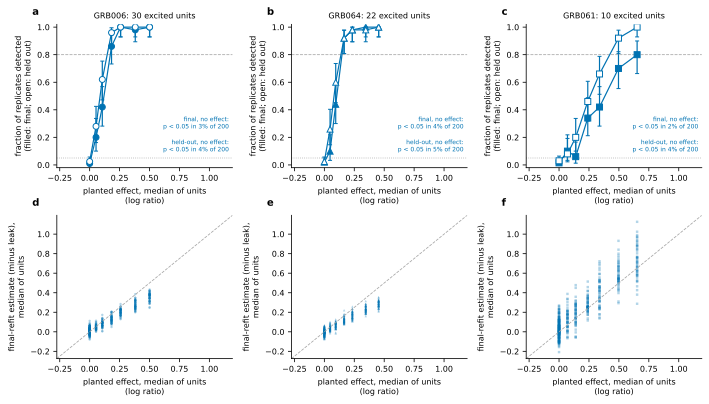

### Left and right turns: does the side difference of the flash response grow as the head turns?

- **Measure (`exit_flash_side.py`, flash-excited units, each mouse alone):** log(peak right / peak left) − log(rate before right / rate before left), within each stimulus category (so slow and fast trials also compare correct and error), for flashes after the exit except the first, < 250 ms and ≥ 250 ms from the exit; the held-out model + noise on the same flashes. Intervals (since 2026-11-07): draws of trials and units together, so they hold the trial noise; no test. Flashes per group: 11–59 / 8–32.
- **Finding:** GRB006: **+0.33** (−0.16 to 0.93) before 250 ms and **−0.12** (−0.51 to 0.38) after; late − early −0.45 (−1.10 to 0.28). With the trial noise in the intervals, the side difference does not change with time after the exit (with a bootstrap over units only it was −0.86 to −0.02). The held-out model gives the same pattern (+0.30 → −0.02), although its flash × side kernel is the same at all times after the exit. Other terms of the model change with time after the exit (the turn term among them), so they can make this pattern; the point is that a model with a side kernel that does not change in time reproduces the observed change, so there is no evidence that the flash-locked side difference grows as the head turns. This measure is not the flash × side kernel: it is a gain-controlled ratio of observed peaks in the excited units, so its positive early value in GRB006 does not contradict the negative median kernel of GRB006. GRB064 has no late value: too few left-turn flashes after 250 ms; early it is −0.80 (−1.49 to 0.15; with units only, −1.36 to −0.14), and the held-out model gives −0.41. The first-flash excess over the in-port flash at the same gap does not grow with its delay after the exit (long − short delay −0.24, −0.13, −0.20 / +0.58, −1.57, +0.89 for gaps 50–100, 100–200, 200+ ms; all intervals include 0 except GRB064 at 100–200 ms, −2.58 to −0.27, a decrease from 21–22 flashes per group; median delays 43–166 ms).
- **Limits:** the delays are short, so the head may not have turned much by the first flash; the side groups are thin.

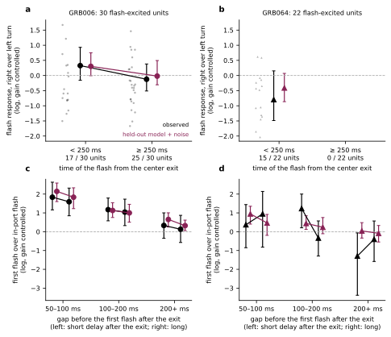

### Before the exit, does V1 follow the choice or the stimulus?

- **Measure (`choice_by_outcome.py`, decoder sessions, single and multi-units):** a decoder trained on correct trials (sides balanced), scored on held-out correct trials and on all error trials (89 / 50), in 200-ms windows from 600 ms before to 300 ms after the exit; AUC for the choice, mean ± SEM across folds; chance from shuffled training labels.
- **Test (one window, 500 to 100 ms before the exit):** the windows of the time course overlap, so they are not independent tests. In one window, the mean output of all decoders gives an error-trial AUC of **0.41 / 0.38** (permutation of the error-trial choices: p = **0.20 / 0.17**; 0.43 / 0.38 before 2026-11-07, another random order of the resamples), with held-out correct trials at 0.67 ± 0.06 / 0.83 ± 0.04 (SEM across folds). Both values lean toward the stimulus, but that is not shown with 89 / 50 error trials. This measure mixes the rates: the error trials are mostly near the boundary, where the stimulus is weak.
- **Time course:** the error-trial AUC stays below 0.5 from 500 to 100 ms before the exit (0.42–0.48 / 0.32–0.49) and rises above 0.5 in the first window that holds time after the exit (centered at −50 ms, it covers −150 to +50 ms: 0.60 / 0.60), then to 0.76–1.00 / 0.75–0.99. The error-trial SEM across folds is very small (about 0.01) because the error trials are the same in every fold; only the training trials change.
- **Matched to the stimulus (2026-11-07, lower row):** at one flash rate the stimulus is the same and the choice splits the trials into correct and error. The AUC of the decoder output for the choice within each rate (correct trials held out), averaged over the rates weighted by n_right · n_left (choice probability), in the same window: **0.57 / 0.62** (choices permuted within each rate: p = **0.16 / 0.03**; 8 / 6 rates with at least 3 trials of each choice). So at a fixed stimulus, GRB064 activity before the exit goes with the choice; GRB006 is in the same direction but not significant. The across-rate error AUC below 0.5 comes from the stimulus, which differs between the rates; it does not exclude a choice signal. In the time course the matched AUC stays at about 0.55–0.6 before the exit and rises to 0.9–1.0 after it.
- **Limits:** a choice signal before the exit can be a preparation of the movement that the camera does not separate (no head tracking); trials with another choice at the same rate can also differ in attention or in the earlier trials.
- **Next:** more error trials (new sessions) to test the choice signal before the exit in both mice, with the same matched measure.

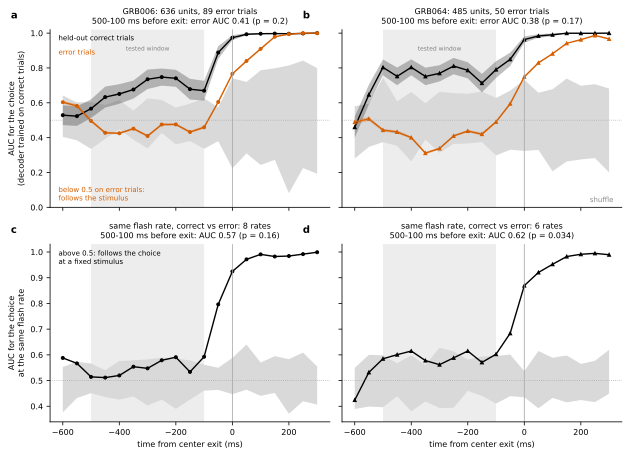

### Gain on all activity, per unit: is the larger flash response after the exit one gain?

- **Measure (`flash_gain_units.py`, flash-excited units, 100–200 ms gaps, the first flash after the exit left out):** per unit, g_b = rate before the flash after the exit / in port, and g_f = flash peak above that rate after the exit / in port. The peak bin is chosen on the flashes of one half of the trials and the window peak around it (±20 ms, since 2026-11-15; one bin before) is read on the other half (both ways, 50 random splits): the largest bin of a noisy trace is biased upward, more in the period with fewer flashes (141 / 46 after the exit against 309 / 246 in port), which would push g_f toward g_b. Intervals (since 2026-11-07): 500 draws of the trials, shared by all units, with the same 50 splits in each draw; error bars in both directions. Until then the bootstrap drew flashes, and the halves were of flashes, so a flash drawn twice could fall in both halves and bring back the bias. The median over units also has an interval from draws of trials and units together. g_f = g_b is one gain on all activity; g_f = 1 an unchanged flash response on a higher background.
- **Finding (window peak, 2026-11-15):** GRB006: median g_b **1.84**, g_f **2.05**; g_f − 1 is **+1.05** (Wilcoxon p = 0.004, 18 of 27 units above 1) and g_f − g_b **−0.68** (p = 0.30). With the trial noise, the intervals of both medians include 0: g_f − 1 −0.09 to +1.87, g_f − g_b −1.68 to +0.66. So GRB006 cannot tell one gain on all activity from an unchanged flash response. GRB064: g_b 1.64, g_f **0.27**; g_f − g_b **−1.73** (−3.13 to −0.37, p = 0.004), g_f − 1 **−0.73** (−1.22 to −0.25, p = 0.002; 1 of 20 units above 1): with the trial noise, the flash response after the exit is smaller than in the port, not one gain, as in the leak-corrected model test. Units with no split-half in-port peak have no g_f: 3 / 2; one GRB064 unit has no in-port rate before the flash, so no g_b, and is left out of g_f − g_b. The figure draws 3 / 2 units past its axes open at the edge. With the largest bin (until 2026-11-15): GRB006 g_f 1.61, g_f − 1 +0.61 (−0.19 to +1.98); GRB064 g_f 0.81, g_f − g_b −1.37 (−2.71 to 0.00), g_f − 1 −0.19 (−1.05 to +0.71).
- **Two forms were tried first and dropped:** (1) one response shape for both periods, scaled by g_f: in some units the shape changes after the exit (unit 197: in the port a dip at 0–40 ms and a peak at 70–90 ms; after the exit a peak at 30–70 ms), and it gave g_f = 0.25 for unit 197; (2) the largest bin of all flashes, which is biased as above (it gave GRB006 g_f 1.67 and g_f − g_b −0.22). Unit 197 has g_f 0.89 with the split-half peak. Old outputs: `results/glm/_superseded_2026_10_29/`.

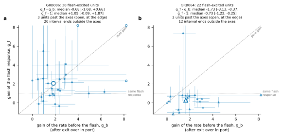

### Movement while waiting: in the port, does the flash response change with body movement?

- **Measure (`flash_movement_in_port.py`, flash-excited units, each mouse alone):** in-port flashes with a gap of 100 ms or more, without the first flash of a trial; rates with the non-flash terms of the held-out model divided out (fixation drop, previous choice, drift, motion-energy PCs). Per flash, the mean rate 40–100 ms after the flash minus the rate 40–0 ms before it, against the total motion energy of the video 100–0 ms before the flash (z-scored); per unit, the slope in percent of the response at average movement.
- **Three-mouse finding:** median response slopes are **−29% / −28% / −45% per
  SD** of motion energy, with **27 / 21 / 10** finite unit slopes. Wilcoxon
  p = **0.00027 / 0.00010 / 0.084**; **22 / 17 / 8** slopes are negative. The
  saved unit-bootstrap 95% intervals are **−46 to −19 / −44 to −19 / −75 to −8**.
  The GRB061 interval and Wilcoxon test summarize different calculations; its
  p value does not pass 0.05. Background median slopes are **+4% / +17% / +0.1%**
  per SD (p = **0.011 / 0.019 / 0.492**).
- **Scope of robustness checks below:** these older controls were run for
  **GRB006 / GRB064 only**. They have not established the same robustness in
  GRB061. [Current three-mouse report](figures/reports/flash_movement_in_port.json).
- **Checks (`--checks`, 2026-11-06):** motion energy from −50 to +100 ms gives −43% / −21% (p = 2e-5 / 0.004), from 0 to +100 ms −40% / −16% (p = 3e-7 / 0.05); the flash does not change the motion energy (0.95 / 0.96 of the level before it); leaving out the flashes in the first 300 ms after the center entry gives −26% / −18% (p = 1e-4 / 7e-4). Movement is larger early in the wait (ρ = −0.43 / −0.59), and with the time since the center entry and the gap as more predictors the slope is **−42% / −12%** (p = 3e-5 / 0.3). So in GRB064 the smaller flash response with movement is not separate from the time in the wait; in GRB006 it is. The checks of 2026-10-30 (GRB064 20260916; −39% / −30% without the first 300 ms, −41% / −32% with the predictors) came from a script that was lost; the new definitions give the same GRB006 value with the predictors and a smaller one without the first 300 ms.
- **Is the fall made by the method? (2026-11-07):** the main rates have the fitted motion-energy part divided out. If movement adds to the rate and does not scale it, that division makes the flash response smaller at high movement by itself. With the motion-energy part kept in the rate (only the fixation, pre-stimulus, previous-choice and drift parts divided out), the flash response still falls: **−32% / −28%** per SD (p = 3e-4 / 1e-4), while the rate before the flash rises (+4% / +17%, p = 0.02 / 0.02). So the fall is not made by the division. With the time since the center entry and the gap as predictors it is −45% / −9% (p = 3e-5 / 0.5), as in the main version: in GRB064 it is still not separate from the time in the wait.
- **Gap of the flash before (2026-10-30):** gaps come in 40-ms steps, so the shortest analyzed gap is 120 ms (46% / 32% of the flashes), and the −40 to 0 ms baseline then lies on the tail of the response to the flash before. With gaps of 200 ms or more only (102 / 66 flashes, GRB064 20261008, 2026-11-04) the flash response still falls with movement (**−14% / −17%** per SD, p < 0.001 / 0.001), but the rise of the rate before the flash is not significant (+8% / +19%, p = 0.34 / 0.05). So the smaller flash response with movement holds; the small rise of the background is not a robust result. The raw in-port rate of `port_vs_stillness.py` (all spikes, no model) answers a different question, whether the low rate in the port is stillness, and is not compared with this measure.
- **Next:** in-port motion energy is associated with smaller flash responses in
  the original two mice; the provisional mouse has the same median direction
  with greater uncertainty. The original GRB064 relation is not separable from
  time in the wait in the adjusted check. These observational results cannot
  isolate movement from engagement or other state changes, and do not prove
  that movement has no direct effect after exit. The model has no in-port
  movement × flash term; testing a term suggested by these data needs new data.

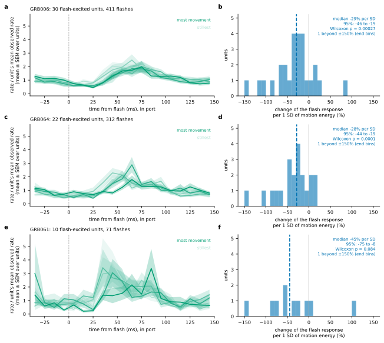

### Do the movement-related kernels depend on depth?

- **Measure (`depth_effects.py`, all GLM units, each mouse alone, Holm over five measures):** Spearman ρ of depth with the fixation level, the after-exit level, and the flash, flash × after exit and flash × side kernels (40–100 ms).
- **Finding:** no kernel changes with depth after Holm correction. The flash kernel comes closest (ρ = −0.18 / +0.24, Holm p = 0.09 / 0.05). No movement-related measure does (all Holm p ≥ 0.09; GRB006 flash × after exit +0.18, GRB064 flash × side +0.14).

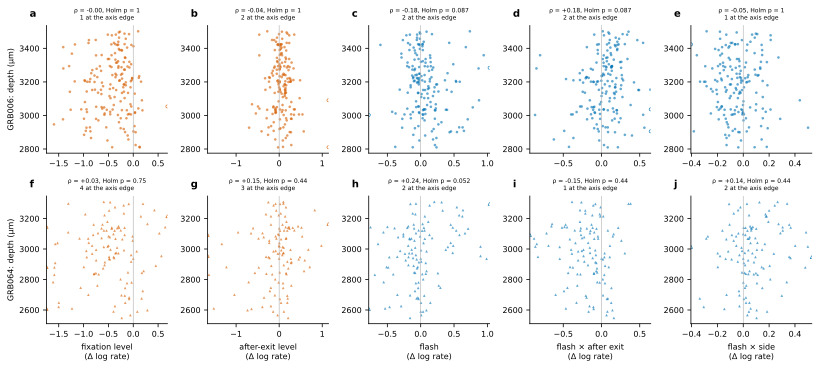

## Methods and reproduction

### Reading the comparisons

- Fixation/exit kernels: median fixation levels are −0.34 / −0.43 Δ log rate; 90% / 86% are negative. 1 / 7 units are outside the axis limits of panel d and remain in the statistics.
- Onset control: long-delay pre-flash rate / pre-entry rate is 0.95 / 0.88 (p = 0.02 / 0.03). Zero ratios remain; tests use ratio minus 1. Approach and entry are unresolved.
- Early withdrawal: after-exit rate, early/completed, is 1.00 / 1.08 (p = 0.53 / 0.02). GRB064 has a separate 78-unit selection for this model-free control.
- Fixation versus flash importance (unique bits per spike of the flash terms, with recovery): ρ = −0.04 / 0.00 (p = 0.56 / 0.97); there is no clear correlation.
- Main-model checks: largest group GVIF^(1/p) is 3.7 / 3.4 (limit 5); largest condition index is 10.1 / 10.0 (limit 30). Split-half agreement among units that need each term is 0.72 / 0.62 for turn, 0.90 / 0.92 for fixation and 0.66 / 0.69 for flash recovery. Agreement is 1 − ‖a − b‖² / (‖a‖² + ‖b‖²). Read spike-history kernels only in units firing at least 5 spikes/s.
- Leak correction: three simulations per unit, with the raw flash × exit regressor at zero and the in-port baseline held fixed. Corrected kernel p = 0.48 / < 0.001. Panels g–i use the measure of the main comparison (peak change over the mean rate of the unit; held-out real part). All values enter tests and intervals.
- Side index: (right rate − left rate) / (right rate + left rate), from 100 ms after exit to response entry; require at least 50 ms per trial. Positive means right preference. Trial-bootstrap intervals are shown on both axes, conditional on saved predictions.

### Data

- Units: quality criteria 1, stability 0; no sensory-response filter for the GLM.
- Exclude GRB006 unit 212 for unstable out-of-fold history extrapolation; GRB064 (20261008) unit 453 has no validation spikes.
- Trials: completed left/right responses, without early withdrawal; require initiation, measured first flash, exit, and response entry in that order.
- Missing required events exclude a trial; invalid event order stops preparation.
- Align to the **first measured flash**. Use −0.5 to +2.1 s at 1 ms; mask bins after response entry.
- The train has 25 slots of 40 ms, starts with a flash, and can stop at response entry.
- Event-kernel baseline: before center entry. Scoring null: constant rate from the corresponding fit trials.
- Sampling unit: neural unit; side-index intervals resample trials. Units share trials.
- Population summaries pool units; bootstrap intervals resample mice, then units. Tests are within mouse.

### Design

- Count model: Poisson(exp(intercept + Xβ)); all terms add in log rate.
- **Flash:** 8 causal raised cosines, 0–150 ms; base response after a long gap, in port.
- **Flash × short gap:** the same 8 bases for gaps ≤50 ms.
- **Flash × after exit:** the same 8 bases on flashes after exit; zero in port.
- **Flash × recovery:** the same 8 bases, scaled by 1 − exp(−gap / 50 ms) minus its mean over the long-gap flashes of the session, for gaps above 50 ms (the first flash of a trial is fully recovered); zero for short gaps. The design metadata stores the center (`flash_recovery_center`).
- **Pre-stimulus:** 1 column from center entry to first flash; code key “fixation.”
- **Fixation:** 10 log-spaced cosines, log(t + 50 ms), to 700 ms; hold the last value until exit; code key “hold.”
- **Response period:** 8 log-spaced cosines, log(t + 25 ms), from exit to 1.3 s; hold the last value until response entry.
- **Turn direction:** those same 8 exit bases × response side, −1 left / +1 right.
- **Previous choice:** 1 signed column through center exit; zero for unknown side.
- **Motion energy:** 10 contemporaneous PC scores.
- **Session drift:** 3 columns from 4 raised cosines; omit one because the model has an intercept.
- **Self-history:** 10 log-spaced bases at strictly past lags, 1–100 ms.
- Right-response kernel = response period + turn; left-response kernel = response period − turn.
- No go-cue, outcome, punishment, response-entry, same-bin history, cross-unit coupling, or pose terms.
- **Finding:** the diagram shows the causal flash, fixation, exit, and history bases used by the current model. It describes model capacity, not a measured neural response.
- **Next:** judge the fitted kernels within these constraints; the design comparison below checks whether changing them improves prediction.

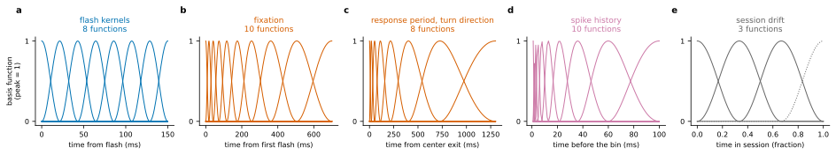

### Video and fit

- Use synchronized camera edges in decoded-frame order; do not use container times.
- Resize grayscale frames to 80 × 64. Motion energy = absolute difference of adjacent decoded frames; zero at gaps.
- Fit 200 PCA axes on original training frames; use the first 10. Raw-video control uses grayscale pixels and adds 10 PCs.
- Scale common columns on valid original training bins; scale history separately on each fit's training rows.
- Initial whole-trial split: 60/20/20, seed 20260912. Validation compares with/without motion energy.
- Ten whole-trial CV folds, seed 20260913; each fold selects its own penalty using inner validation.
- One L2 penalty per unit/model, from 10⁻⁶ to 10⁴ in powers of ten; intercept unpenalized.
- Fit stronger penalties first, retry failed warm starts, and break loss ties toward the stronger penalty.
- Final refit: all valid trials, using the median fold penalty.
- Held-out scores and predictions come from saved fold models; predictions condition on observed spike history.
- A fold with no test spikes is skipped; require at least two scored folds. Report mean and SEM over scored folds.
- Common PCA and scaling are fixed across folds, so these scores do not validate the whole preprocessing procedure.

### Unique explained deviance and inclusion

- Unique ΔD² = full-model D² − D² with one block shuffled. It is reported in held-out bits per spike: in a fold, ΔD² times the full model's bits/D² of that fold (`unique_dev.add_bits_per_spike`; the factor depends only on the data). The inclusion decisions are the same in either measure.
- Maximal ΔD² = D² with only that block intact − all-shuffled D².
- Refit comparators within the same ten trial folds, at each fold's selected penalty.
- Shuffle valid bins within trial; keep a block's columns together.
- Drift swaps between trials. Side terms take another trial's actual side code while keeping their own timing.
- Shuffle side terms in **raw columns before centering/scaling**; retain unknown codes and zero support.
- Motion-energy control swaps the video of another trial at the same within-trial time.
- Inclusion requires positive population gain (one-sided Wilcoxon) and more units with reliable gain than the nominal 5% chance rate (binomial test).
- A unit “needs” a term when its fold gains pass a one-sided t-test at p < 0.05. Apply Holm correction across regressors to the population tests.
- All 13 terms pass in both mice. Turn is needed by **84/172 / 62/115** units; previous choice by **34/172 / 21/115**; flash recovery by **48/172 / 26/115**.
- Shared training trials and shared neural trials make these tests approximate.

### Design choices

- **Finding:** paired comparisons on four fixed 20-unit GRB006 samples retain 150-ms flash kernels, a short-gap modifier, the held 700-ms fixation kernel, and the exit-aligned response period. Finer gap classes, more video PCs (also 200 PCs with a 100 or 1000 times stronger video penalty; [decisions](glm_decisions.md#200-motion-energy-pcs-with-a-video-penalty-2026-10-24)), and longer exit windows give no clear improvement. Recovery and collinearity also inform the choice. GRB064 takes no part in the choice of forms. It did take part in the choice of terms: the candidate tests of 2026-10-15 used both mice, and flash × motion energy stayed out because it failed in GRB064. So GRB064 is held out for the forms, not for the set of terms; only a third mouse can test the set of terms.
- **Next:** keep this design fixed for the comparisons above. Earlier choices are in [the decision history](glm_decisions.md).

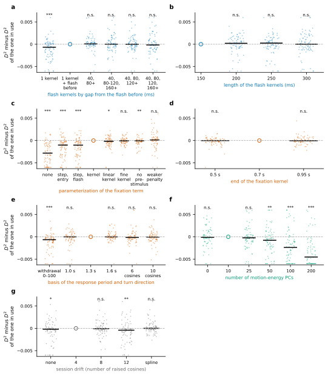

### Run and inspect

- Source: [GLM modules](../src/thesis/ephys/analyses/glm/).
- Use cached trial/unit tables and low-priority fits:

~~~bash
export THESIS_CACHE_DIR=figures/cache
nice -n 10 uv run glm prepare
nice -n 10 uv run glm fit --units all --workers 2
nice -n 10 uv run glm unique --units all --workers 2
~~~

- Defaults are GRB006. Repeat with --subject GRB064 --session 20261008_143359.
- Before first prepare, supply frame_times.npy and one local cam0 video. The camera-pulse audit helper is specific to GRB006.
- Sample mode uses 20 fixed units, seed 20260914; sample1, sample2, … use disjoint groups.
- Outputs: data (fits, designs, caches, result tables) in `results/glm/<subject>_<session>/` and `results/glm/`; figures and captions at the same paths under `figures/glm/`. Restart records: `all_fit_me/checkpoints/`. The trial and unit cache stays in `figures/cache` (`THESIS_CACHE_DIR`).
- Preserve affected designs/checkpoints before changing inputs. Design reuse checks do not detect every basis or input change.
- Figures read completed fits and control arrays. The main document uses flash_movement (observations and matched held-out rate predictions) and main_figure; the other commands below draw supporting views:

~~~bash
THESIS_CACHE_DIR=figures/cache nice -n 10 uv run python -m thesis.ephys.analyses.glm.flash_movement
uv run python -m thesis.ephys.analyses.glm.main_figure
uv run python -m thesis.ephys.analyses.glm.hold_effect
uv run python -m thesis.ephys.analyses.glm.flash_kernels  # unit kinds for flash_by_gap; no figure
uv run python -m thesis.ephys.analyses.glm.flash_by_gap
THESIS_CACHE_DIR=figures/cache uv run python -m thesis.ephys.analyses.glm.flash_weight_check
THESIS_CACHE_DIR=figures/cache nice -n 10 uv run python -m thesis.ephys.analyses.glm.first_flash_after_exit
THESIS_CACHE_DIR=figures/cache nice -n 10 uv run python -m thesis.ephys.analyses.glm.calibration
uv run python -m thesis.ephys.analyses.glm.model_trust
~~~

- Control arrays come from collinearity, parameter_recovery, kernel_reliability, and leak_test; hold_effect also reads the model-free onset, exit, and motion controls.
- Flash-excited units (`results/glm/flash_excited_units.json`, read by every analysis of the excited units): the stable units that StimulusResponse classes as excited (`peaks.excited_units`). The command writes the file and reports a saved list that differs from the rule; it needs the database:

~~~bash
uv run python -m thesis.ephys.analyses.glm.peaks
~~~

- Raw-video comparison and side preference:

~~~bash
nice -n 10 uv run python -m thesis.ephys.analyses.glm.raw_video_full --workers 4
nice -n 10 uv run python -m thesis.ephys.analyses.glm.raw_video_trust --workers 4
nice -n 10 uv run python -m thesis.ephys.analyses.glm.side_preference
nice -n 10 uv run python -m thesis.ephys.analyses.glm.side_preference --raw-video
~~~

- Run the synthetic check after design, fit, or shuffle changes; use a new output directory:

~~~bash
nice -n 10 uv run python -m thesis.ephys.analyses.glm.synthetic_check --out <new-directory>
~~~

- JSON reports beside the figures retain exact statistics and unit IDs; generated caption files give panel details.
- Earlier designs, retired tests, and penalty checks: [glm_decisions.md](glm_decisions.md).

### Related methods

- [Truccolo et al. 2005](https://pubmed.ncbi.nlm.nih.gov/15356183/) and [Pillow et al. 2008](https://sites.stat.columbia.edu/liam/research/pubs/pillow-nature-08.pdf): spiking GLMs with self-history.
- [Talluri et al. 2023](https://pmc.ncbi.nlm.nih.gov/articles/PMC10620084/) and [Stringer et al. 2019](https://pmc.ncbi.nlm.nih.gov/articles/PMC6525101/): video-based behavioral predictors.

### What information do the raw-video components contain in each mouse?

- **Finding:** the first ten components explain **74.3% / 40.9%** of training-frame variance. The maps below show the GRB006 back view, then the GRB064 bottom view. Components mix posture, position, and illumination; brightness correlations reach **|ρ| = 0.64 / 0.65**. The two views are different measures.
- **Next:** interpret added video as a broad nuisance control. Identifying locomotion, posture, or illumination requires a more specific measurement; there is no useful pupil measurement here.

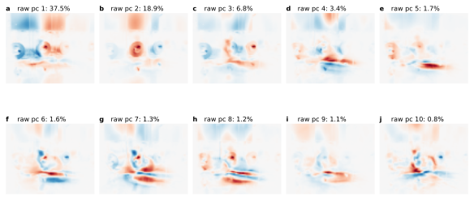

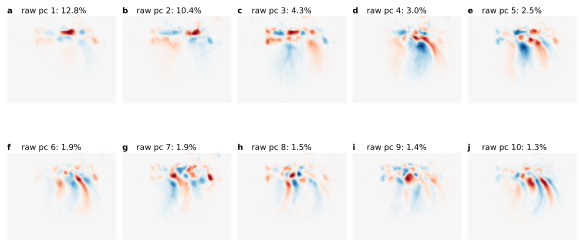

### Which checks remain incomplete?

- The synthetic pipeline check passes. It does not resolve the known fixation-weight bias or validate the new kernel-peak measure against leak.
- The main flash extension has three mice, one provisional; most controls still have only two mice, one session each. Neither scope establishes broad replication across animals. There is no useful pupil measurement, and video does not isolate locomotion, posture, or illumination.
